<h1 align="center">Amirhossein Hajilari</h1>

<h3 align="center">Software Engineer</h3>

  <strong>Full Stack Development · Business Automation · Systems Integration</strong>

  Building web applications and automation for finance and logistics.

  
  

## About me

Hi, I'm **Lary** — a Software Engineer working across frontend development, backend systems, and business automation.

I build applications that help teams manage complex workflows, connect their systems, and work with their data. My interests include **financial automation**, **logistics platforms**, and **usable enterprise interfaces**.

I care about clear architecture, reusable components, predictable APIs, and software that is easy to maintain.

## Tech stack

### Languages

  
  
  

**Backend & APIs**

  
  

**Frontend**

  
  

**Database**

  

**State & data fetching**

  
  
  

**UI & forms**

  
  
  
  

**Tools & practices**

  
  
  

  
More experience & engineering interests

- **Additional tools:** Formik, Bootstrap, Webpack, HTML, CSS.
- **Interface engineering:** reusable components, complex forms, data grids, RTL, and localization.
- **Application design:** API integration, validation, error handling, and access control.
- **Ways of working:** version control, automated tests, and iterative delivery.

## Selected work

### Finance Automation Engine

Python-based automation connecting operational and financial systems, with invoice and payment processing, mapping rules, retries, and reconciliation.

### Chapar Operational Portal

React and TypeScript interfaces for logistics operations, including orders, consignments, fleet management, and data-heavy workflows.

### Document Management System

Interfaces for organizing documents, managing access, and supporting document workflows across organizational teams.

### Enterprise Newsletter

Python-powered subscription workflows with multilingual confirmation and unsubscribe experiences.

## GitHub activity

<picture>
  <source media="(prefers-color-scheme: dark)" srcset="./profile/stats-dark.svg" />
  <source media="(prefers-color-scheme: light)" srcset="./profile/stats-light.svg" />
  
</picture>

<picture>
  <source media="(prefers-color-scheme: dark)" srcset="./profile/languages-dark.svg" />
  <source media="(prefers-color-scheme: light)" srcset="./profile/languages-light.svg" />
  
</picture>

<!-- STATS:START -->
Last successful refresh: 2026-10-23T12:20:02Z · Scheduled every 6 hours.
<!-- STATS:END -->

Language usage describes repository content. Some professional work may not be represented in public statistics.
